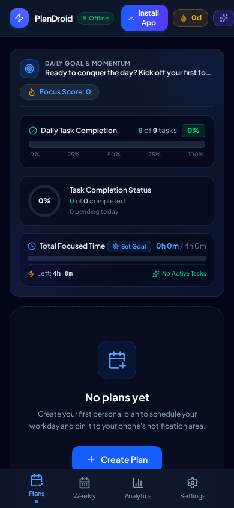
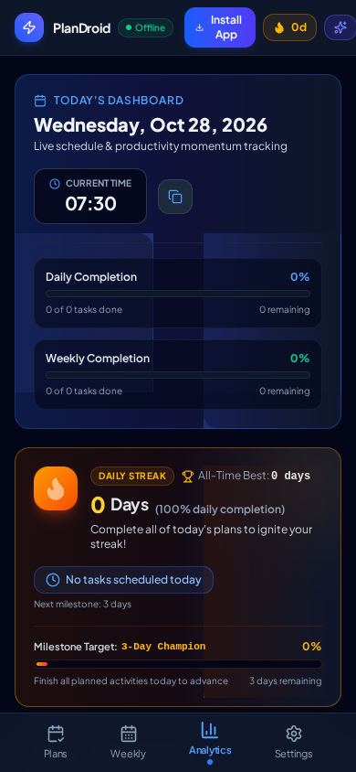
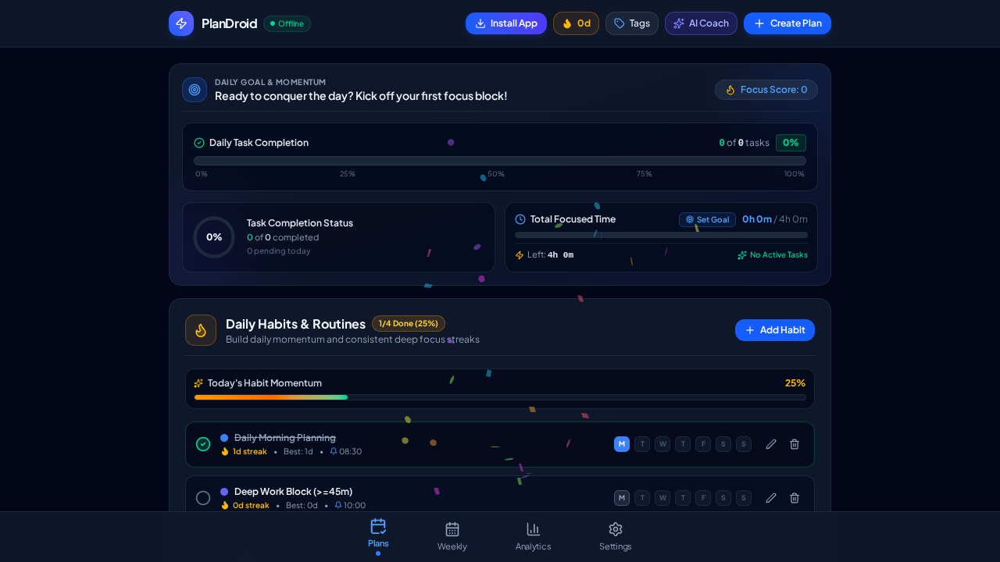
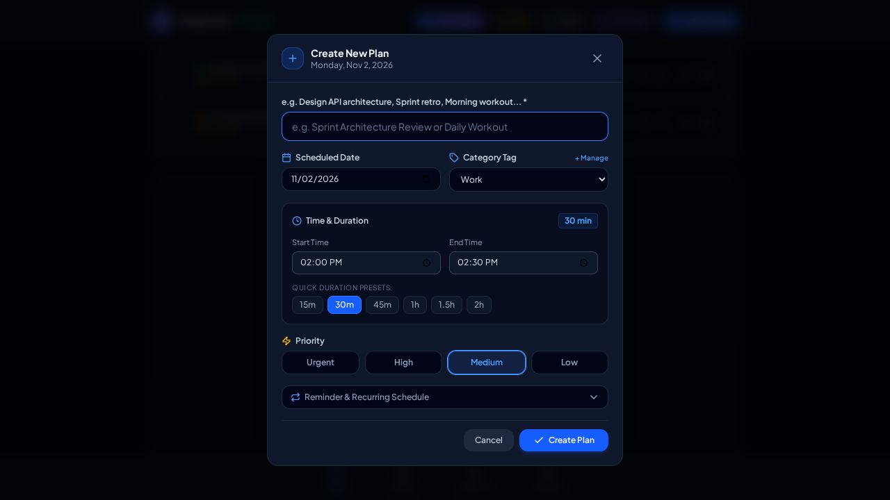
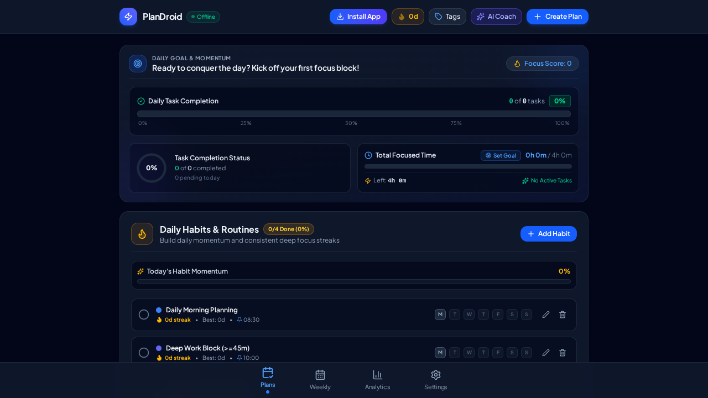

# PlanDroid — Offline-First Smart Task Planner & Focus Scheduler


---

## 📖 Project Overview

**PlanDroid** is a modern, **offline-first** productivity and daily planning application designed to help professionals, students, and anyone seeking structured time management optimize their workday. Built as a **Progressive Web App (PWA)**, it runs seamlessly on desktop browsers and installs natively on Android/iOS devices—providing a unified experience across platforms without requiring separate codebases.

### Core Philosophy

PlanDroid goes beyond simple to-do lists by combining:

- **Intelligent Auto-Scheduling** — Tasks automatically slot into your workday based on priority, energy levels, and preferred time windows
- **Persistent Notification Pinning** — Active plans appear in your phone's notification drawer for glanceable, one-tap access
- **Focus Timer with Ambient Audio** — Pomodoro-style countdown/stopwatch with brown noise, rain, white noise, and alpha wave tracks
- **Gamified Momentum Tracking** — Daily streaks for 100% task completion, weekly analytics, and milestone rewards
- **Offline-First Architecture** — All data stored locally via localStorage + IndexedDB; zero cloud dependency required

### Who Is It For?

- **Knowledge Workers** — Engineers, designers, writers needing deep-work blocks
- **Students** — Managing study sessions, assignments, and revision schedules
- **Freelancers** — Juggling client meetings, admin, and focused project time
- **Anyone** seeking a distraction-free, privacy-respecting daily planner

---

## ✨ Key Features

### 🗓️ Daily Planning & Smart Scheduling
| Feature | Description |
|---------|-------------|
| **Auto-Schedule Engine** | Tasks automatically placed in Morning/Afternoon/Evening blocks based on priority, category, and preferred slots |
| **Natural Language Input** | Type `"Deep work 45m urgent morning"` → instantly parsed into structured plan |
| **Fixed-Time Locking** | Pin critical meetings to exact time slots; engine works around them |
| **Conflict Detection** | Real-time overlap warnings when scheduling |
| **One-Click Rebalance** | Shift entire remaining day forward from current time with a single tap |
| **Recurring Tasks** | Daily, weekdays, weekly, or custom day-of-week patterns |

### ✅ Task Management
- **Rich Task Properties**: Title, description, category, duration, priority (Urgent/High/Medium/Low), energy level, preferred time window
- **Custom Categories & Color Tags** — Create personalized tags (Work, Study, Fitness, etc.) with 12-color palette
- **Drag-to-Reorder** — Manual timeline ordering with touch/mouse support
- **Kanban Board View** — Active / Queued / Completed columns with drag-and-drop
- **Quick-Start Presets** — One-tap: Deep Work (45m), Team Sync (30m), Break (15m)

### 🎯 Goal Setting & Progress Tracking
- **Daily Focus Target** — Set hourly deep-work goal (default 4h)
- **Weekly Focus Target** — Aggregate weekly commitment (default 20h)
- **Live Progress Bars** — Daily & weekly completion percentages with motivational messages
- **Actual vs. Planned Time** — Accumulated focus minutes tracked per task and via focus sessions

### ⏱️ Focus Timer (Pomodoro-Style)
- **Countdown & Stopwatch Modes** — Flexible session types
- **Focus / Break Toggle** — Seamless transition between work and recovery
- **Ambient Audio Tracks**: Brown Noise, White Noise, Rain, Alpha Wave (10Hz), Off
- **1-Minute Warning Chime** — Gentle alert before session ends
- **Configurable Alarm Melodies**: Classic Bell, Digital, Harmonic Chime, Gentle Harp
- **Sustained/Repeating Alarms** — Play once, every 15s/30s/1m/2m, or continuous pulse
- **Background Persistence** — Timer survives tab switches, screen off, app minimize via `document.visibilitychange` + timestamp-based calculation
- **Floating Mini-Bar** — Collapsed timer view when modal closed; quick pause/resume/expand

### 🔔 Notifications & Reminders
- **Pinned Notification Drawer** — Active task always visible at top of timeline
- **Android/OS Notification Pinning** — Push active plan to phone status bar (requires permission)
- **Task Start Reminders** — Configurable offsets (0/5/10/15/30/60 min before)
- **Persistent Nudges** — Periodic reminders for unfinished urgent tasks (15/30/60 min intervals)
- **Quiet Hours** — Automatic Do-Not-Disturb window (default 22:00–07:00)
- **Vibration Support** — Haptic feedback on timer completion (where supported)

### 📊 Analytics & Productivity Dashboard
- **7-Day Interactive Charts** (Recharts) — Completed tasks, focus sessions, focused time
- **Summary Cards**: Weekly tasks, completion rate, planned vs. actual focus time
- **Streak Gamification** — Consecutive 100% completion days with milestones (3, 7, 14, 21, 30, 60, 100+)
- **Overdue & Upcoming Task Lists** — Actionable cards with one-tap timer start
- **Daily Briefing Copy** — One-click clipboard export of today's status

### 🤖 AI Productivity Coach (Gemini Integration)
- **Context-Aware Chat** — Knows your streak, today's tasks, completion status, schedule
- **Coaching Specialties**: Streak protection, task breakdown into 25m blocks, schedule optimization, cognitive reset rituals
- **Conversation Persistence** — LocalStorage history survives reloads
- **Fallback Responses** — Works offline when API unavailable

### 🌐 Internationalization
- **English** (default)
- **Amharic (አማርኛ)** — Full UI translation including date formatting

### 💾 Data & Backup
- **Local-First Storage** — localStorage + IndexedDB mirror for durability
- **Full JSON Backup/Restore** — Tasks, habits, categories, config, settings, focus sessions, daily goal
- **Project Source ZIP Download** — Complete source code archive
- **Auto-Recovery** — IndexedDB fallback if localStorage cleared

---

## 🌐 Web Application

PlanDroid runs as a **single-page React application** served via Vite/Express.

### Interface & User Experience
- **Responsive Layout** — Mobile-first, scales to desktop (max-width 4xl container)
- **Dark Theme Default** — OLED-friendly slate-950 background; Light/System modes available
- **Fixed Bottom Navigation** — 4 tabs: Plans (Timeline/Kanban), Weekly Planner, Analytics, Settings
- **Sticky Top Bar** — App branding, streak badge, category manager, AI coach, rebalance, create plan
- **Modal-Based Workflows** — Plan creation/editing, focus timer, category manager, AI chat, schedule optimizer

### Core Views
| View | Description |
|------|-------------|
| **Timeline (Plans)** | Morning/Afternoon/Evening segments with draggable task cards, search, filters |
| **Kanban (Plans)** | Active / Queued / Completed columns with category filter chips |
| **Weekly Planner** | Calendar, Agenda, List modes; 7-day grid with conflict detection; copy-to-day |
| **Analytics** | Live clock, progress bars, streak card, next-task action, Recharts dashboard, overdue/upcoming |
| **Settings** | 6 sections: Planning prefs, Language, Alarm sounds, Notifications, Workday schedule, Backup |

### Technical Highlights
- **Service Worker** (Workbox) — Precaches all assets; offline-capable; `NavigationRoute` for SPA fallback
- **Web App Manifest** — `display: standalone`, portrait orientation, maskable icons for Android WebAPK
- **Visual Viewport Handling** — Modals adapt to mobile keyboard open/close
- **No External CDN Dependencies** — All fonts (Plus Jakarta Sans, JetBrains Mono, Noto Sans Ethiopic) self-hosted or preconnected

---

## 📱 Mobile Application (PWA)

PlanDroid is a **Progressive Web App** — installable on Android, iOS, and desktop without app store distribution.

### Installation
| Platform | Method |
|----------|--------|
| **Android (Chrome/Edge)** | Menu → "Install app" or "Add to Home screen" |
| **iOS (Safari)** | Share → "Add to Home Screen" |
| **Desktop (Chrome/Edge)** | Address bar install icon or Menu → "Install PlanDroid" |

### Mobile-Optimized Features
- **Touch-First Interactions** — Drag-to-reorder via touch, swipe-friendly cards, large tap targets (min 44×44px)
- **Safe Area Insets** — Respects notches, home indicators, bottom navigation bar
- **Visual Viewport Adaptation** — Modals resize when virtual keyboard appears
- **Portrait Lock** — `orientation: portrait` in manifest for focused experience
- **Standalone Display** — No browser chrome; feels like native app
- **Background Timer Persistence** — Focus timer continues when screen off or app backgrounded
- **Native Notification Integration** — Service Worker shows persistent notifications with vibration patterns

### PWA Configuration (`vite.config.ts` + `manifest.json`)
```json
{
  "display": "standalone",
  "orientation": "portrait",
  "theme_color": "#0f172a",
  "background_color": "#0f172a",
  "icons": [
    { "src": "/pwa-192x192.png", "sizes": "192x192", "purpose": "any" },
    { "src": "/pwa-maskable-192x192.png", "sizes": "192x192", "purpose": "maskable" },
    { "src": "/pwa-512x512.png", "sizes": "512x512", "purpose": "any" },
    { "src": "/pwa-maskable-512x512.png", "sizes": "512x512", "purpose": "maskable" }
  ]
}
```

---

## 🛠️ Technology Stack

| Layer | Technology | Version |
|-------|------------|---------|
| **Framework** | React | 19.0 |
| **Language** | TypeScript | 7.0 |
| **Build Tool** | Vite | 8.3 |
| **Styling** | Tailwind CSS | 4.3 (Vite plugin) |
| **Routing** | SPA (hash/history via NavigationRoute) | — |
| **State Management** | React Hooks (useState, useReducer, useMemo, useCallback) | — |
| **Persistence** | localStorage + IndexedDB (custom wrapper) | — |
| **Charts** | Recharts | 3.10 |
| **Icons** | Lucide React | 0.546 |
| **Animations** | Motion (Framer Motion) | 12.23 |
| **Audio** | Web Audio API (custom synthesizers) | — |
| **Confetti** | canvas-confetti | 1.9 |
| **AI Integration** | @google/genai (Gemini 3.8 Flash / 3.1 Flash-Lite) | 2.4 |
| **Server (Dev/Prod)** | Express | 4.21 |
| **PWA** | vite-plugin-pwa + Workbox | 2.0 / 7.x |
| **Date/Time** | Native Intl + custom utilities | — |
| **Internationalization** | Custom i18n module (EN/AM) | — |
| **Linting/Typecheck** | TypeScript `tsc --noEmit` | — |

### Development Dependencies
- `tsx` — TypeScript execution for server
- `esbuild` — Fast bundling for server
- `sharp` — Icon generation at build time
- `autoprefixer` — CSS vendor prefixes

---

## 🎨 UI/UX Design

### Design System
- **Color Palette**: Slate-950 base, Blue-600 primary, Emerald-500 success, Amber-500 warning, Rose-500 danger, Indigo-600 focus
- **Typography**: Plus Jakarta Sans (UI), JetBrains Mono (timers/codes), Noto Sans Ethiopic (Amharic)
- **Spacing**: 4px base unit; consistent 2.5/3/4/5/6 scale
- **Border Radius**: xl (12px) cards, 2xl (16px) sections, full (9999px) pills
- **Shadows**: Layered depth (shadow-sm → shadow-2xl) with colored glows for active states

### Responsive Breakpoints
- **Mobile**: `< 640px` — Single column, bottom nav, stacked modals
- **Tablet**: `640px–1024px` — Two-column grids, side-by-side forms
- **Desktop**: `> 1024px` — Max-width 4xl (896px), centered container, hover states

### Accessibility
- Semantic HTML5 (`<header>`, `<main>`, `<section>`, `<nav>`, `<aside>`)
- ARIA labels on all icon-only buttons
- Focus-visible outlines (blue-500 ring)
- Color contrast ≥ 4.5:1 (WCAG AA)
- `prefers-reduced-motion` respected via Tailwind
- Screen-reader friendly live regions for timer announcements

### Micro-Interactions
- Spring animations (Motion) on modal open/close
- Staggered list item entrance
- Confetti bursts on task completion
- Pulse on active timer indicator
- Haptic-style button press (active:scale-95)

---

## ⚙️ Installation & Setup

### Prerequisites
- **Node.js** ≥ 20.x
- **npm** ≥ 10.x (or Bun ≥ 1.1)
- **Git**

### Quick Start

```bash
# Clone repository
git clone <repository-url>
cd PlanDroid

# Install dependencies
npm install
# or: bun install

# Development server (Express + Vite middleware)
npm run dev
# or: bun run dev

# Production build
npm run build

# Preview production build
npm run preview

# Type-check only
npm run lint
```

### Environment Variables
Create `.env` in project root for AI Coach:

```env
GEMINI_API_KEY=your_google_ai_studio_api_key
PORT=3000
```

> **Note**: The AI Coach falls back to contextual offline responses when API key is absent or quota exceeded.

### PWA Development Notes
- Service Worker registers automatically via `registerSW({ immediate: true })` in `main.tsx`
- In development, PWA is enabled (`devOptions: { enabled: true }`)
- Test offline: DevTools → Application → Service Workers → "Offline" checkbox
- Clear storage: DevTools → Application → Clear storage → "Unregister service workers"

### Mobile Testing
```bash
# Expose dev server to LAN for phone testing
npx vite --host 0.0.0.0 --port 3000
# Then visit http://<your-laptop-ip>:3000 on phone browser
```

---

## 📸 Screenshots & Preview

> **Add screenshots to `/artifacts/screenshots/` or `/public/screenshots/` and reference them below.**

| View | Preview |
|------|---------|
| **Timeline (Mobile)** |  |
| **Analytics Dashboard** |  |
| **Focus Timer Modal** |  |
| **Quick Action Modal** |  |
| **Initial Empty State** |  |

### Suggested Screenshot Checklist
- [ ] Empty state (first launch)
- [ ] Timeline with morning/afternoon/evening tasks
- [ ] Kanban board with 3 columns
- [ ] Weekly planner (Calendar / Agenda / List)
- [ ] Analytics dashboard with Recharts
- [ ] Focus timer modal (countdown + stopwatch)
- [ ] Pinned notification drawer
- [ ] Settings panels (Alarm, Notifications, Workday)
- [ ] AI Coach chat modal
- [ ] Category manager
- [ ] Habit tracker with 7-day dots
- [ ] Mobile home screen icon installed

---

## 📁 Project Structure

```
PlanDroid/
├── public/                          # Static assets (served as-is)
│   ├── manifest.json                # PWA manifest (legacy)
│   ├── manifest.webmanifest         # PWA manifest (standard)
│   ├── sw.js                        # Workbox service worker (generated)
│   ├── workbox-*.js                 # Workbox runtime
│   ├── registerSW.js                # SW registration helper
│   ├── pwa-*.png                    # App icons (192/512, maskable)
│   ├── apple-touch-icon.png         # iOS home screen icon
│   ├── favicon.ico
│   ├── icon.svg                     # SVG icon
│   ├── fonts/                       # Self-hosted fonts
│   │   └── noto-sans-ethiopic.woff2
│   └── plandroid-source.zip         # Downloadable source archive
├── src/
│   ├── main.tsx                     # App entry + SW registration
│   ├── App.tsx                      # Root component (state, routing, modals)
│   ├── index.css                    # Tailwind v4 imports + global styles
│   ├── vite-env.d.ts                # Vite type declarations
│   ├── components/                  # React components (22 files)
│   │   ├── AnalyticsView.tsx        # Dashboard + Recharts + streak
│   │   ├── BottomNavBar.tsx         # Fixed 4-tab navigation
│   │   ├── CategoryManagerModal.tsx # Custom tag CRUD
│   │   ├── DailyGoalSummary.tsx     # Progress bar + target setter
│   │   ├── DailyGoalSummaryWidget.tsx
│   │   ├── FeaturesView.tsx         # Feature showcase (landing)
│   │   ├── FloatingActiveTimer.tsx  # Collapsed background timer bar
│   │   ├── FocusTimerModal.tsx      # Full-screen Pomodoro timer
│   │   ├── GeminiChatModal.tsx      # AI productivity coach
│   │   ├── HabitsTracker.tsx        # Daily habits + 7-day dots
│   │   ├── KanbanView.tsx           # Active/Queued/Completed board
│   │   ├── PinnedNotificationDrawer.tsx # Top pinned task card
│   │   ├── PlanFormModal.tsx        # Create/edit plan with NLP
│   │   ├── ProductivityDashboard.tsx # 7-day Recharts visualization
│   │   ├── ScheduleOptimizerModal.tsx # Workday config + rebalance
│   │   ├── SettingsView.tsx         # 6-section preferences
│   │   ├── TaskSuggestionBar.tsx    # NLP auto-schedule input
│   │   ├── TimelineView.tsx         # Morning/Afternoon/Evening segments
│   │   ├── WeeklyPlannerView.tsx    # 7-day grid/agenda/list
│   │   └── *.test.tsx               # Component tests (if any)
│   ├── types/
│   │   └── index.ts                 # All TypeScript interfaces
│   └── utils/                       # Pure utility modules (15 files)
│       ├── audio.ts                 # Web Audio API synthesizers
│       ├── categoryUtils.ts         # Custom category management
│       ├── dateUtils.ts             # Date formatting, week logic, conflicts
│       ├── habitUtils.ts            # Habit CRUD + streak calculation
│       ├── i18n.ts                  # EN/AM translations (400+ keys)
│       ├── indexedDB.ts             # IndexedDB wrapper
│       ├── notifications.ts         # Web Notifications + SW integration
│       ├── reminderService.ts       # Task start reminder monitoring
│       ├── reorderUtils.ts          # Drag-to-reorder logic
│       ├── scheduler.ts             # Auto-schedule + rebalance engine
│       ├── streakUtils.ts           # 100% completion streak tracking
│       ├── storage.ts               # localStorage + IndexedDB sync
│       └── themeUtils.ts            # Dark/Light/System theme resolver
├── server.ts                        # Express + Vite middleware + Gemini API
├── package.json
├── tsconfig.json
├── vite.config.ts                   # Vite + PWA + Tailwind config
├── bun.lock                         # Bun lockfile
├── metadata.json                    # Project metadata
└── *.png                            # Screenshots (repo root)
```

### Key Architectural Patterns
- **Single State Owner** — `App.tsx` holds all canonical state; child components receive props + callbacks
- **Optimistic Updates** — Local state changes immediately; persistence effects sync to storage
- **Timestamp-Based Timers** — No `setInterval` drift; `targetEndTime` + `Date.now()` for accuracy
- **Dual Persistence** — localStorage (synchronous) + IndexedDB (async mirror) for durability
- **Modular Utils** — Each domain (scheduler, notifications, audio) isolated in `/src/utils/`

---

## 🚀 Future Improvements

### Planned Enhancements
- [ ] **Cloud Sync (Optional)** — Encrypted backup to user-controlled storage (WebDAV, S3, Google Drive)
- [ ] **Team Workspaces** — Shared boards with real-time collaboration (WebRTC/WebSocket)
- [ ] **Calendar Integration** — Two-way sync with Google Calendar / Outlook (.ics import/export)
- [ ] **Widget Support** — Android/iOS home screen widgets showing active task + timer
- [ ] **Voice Input** — Speech-to-text for plan creation (Web Speech API)
- [ ] **Advanced Recurrence** — Monthly, quarterly, "every N weeks", exception dates
- [ ] **Time Tracking Reports** — CSV/PDF export with project/client breakdown
- [ ] **Focus Music Integration** — YouTube/Spotify embed for curated playlists
- [ ] **Pomodoro Statistics** — Session length distribution, interruption count, focus quality score
- [ ] **Accessibility Audit** — Full WCAG 2.1 AA compliance certification

### Technical Debt & Refactoring
- [ ] Migrate to React 19 `use` hook for async resources
- [ ] Introduce Zustand/Jotai for global state if complexity grows
- [ ] Add unit tests (Vitest) for scheduler, streak, date utils
- [ ] E2E tests (Playwright) for critical flows: create plan → timer → complete → streak
- [ ] Bundle analysis & code splitting for faster initial load
- [ ] Replace `canvas-confetti` with lightweight custom implementation

---

## 📄 License & Contact

### License
**MIT License** — Free for personal and commercial use. See [LICENSE](LICENSE) for full text.

### Attribution
PlanDroid uses the following open-source libraries (gratitude to their maintainers):
- React, Vite, Tailwind CSS, Workbox, Recharts, Lucide, Motion, canvas-confetti, @google/genai, Express

### Developer
**PlanDroid** — Built with ❤️ for offline-first productivity enthusiasts.

- **GitHub**: [@your-username/PlanDroid](https://github.com/your-username/PlanDroid)
- **Issues**: [GitHub Issues](https://github.com/your-username/PlanDroid/issues)
- **Discussions**: [GitHub Discussions](https://github.com/your-username/PlanDroid/discussions)

### Contributing
1. Fork the repository
2. Create a feature branch (`git checkout -b feature/amazing-feature`)
3. Commit changes (`git commit -m 'Add amazing feature'`)
4. Push to branch (`git push origin feature/amazing-feature`)
5. Open a Pull Request

> **Code Style**: TypeScript strict mode, ESLint (via `tsc --noEmit`), Prettier formatting. Run `npm run lint` before committing.

---

## 🙏 Acknowledgments

- **Web Audio API** — For zero-dependency alarm/ambient sound synthesis
- **Workbox Team** — For battle-tested Service Worker tooling
- **Recharts Authors** — For beautiful, accessible charting
- **Lucide** — For the clean, consistent icon set
- **Google AI (Gemini)** — For the productivity coach integration
- **Tailwind CSS Team** — For the utility-first styling revolution
- **Vite Team** — For the lightning-fast developer experience

---

**Made with Focus, Discipline, and Code.** 🚀

*PlanDroid — Your offline productivity companion.*